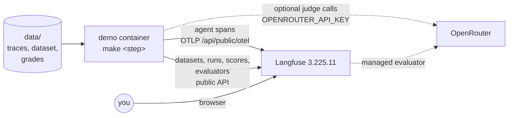

# Setup and settings

## Contents

- [How the demo works](#how-the-demo-works)
- [Langfuse's compose file](#langfuses-compose-file)
- [Settings](#settings)
- [Ports](#ports)
- [LLM key](#llm-key)
- [Your own Langfuse](#your-own-langfuse)
- [Timestamps](#timestamps)
- [Running a step again](#running-a-step-again)
- [Exporting the data again](#exporting-the-data-again)

## How the demo works

The demo container reads the exported study data from `data/` and writes it to
Langfuse. It sends the agent's spans to Langfuse's OpenTelemetry endpoint, and it
creates everything else through Langfuse's public API. With an LLM key, Langfuse
and the demo also call OpenRouter for the judge models.



## Langfuse's compose file

Langfuse runs from Langfuse's own `docker-compose.yml`, the file at the
[v3.225.11 tag](https://github.com/langfuse/langfuse/blob/v3.225.11/docker-compose.yml).
The repo doesn't keep a copy of it. Instead, `make` downloads it into
`langfuse/docker-compose.yml`, which is gitignored, and checks it against the
SHA-256 in the `Makefile`. If the checksum doesn't match, `make` deletes the
download and stops. This needs `curl`, and `sha256sum` (or `shasum` on macOS).

The demo's own `docker-compose.yml` is an overlay on Langfuse's file, and it adds
three things:
- It pins Langfuse's images to 3.225.11, the version the data was recorded on,
  because Langfuse's file uses the `:3` tag, which moves to each new release.
- It publishes the web app and MinIO on 127.0.0.1 only. Langfuse's file publishes
  them on every network interface, and the demo's sign-in, API keys and secrets
  are in this repo.
- It adds the `demo` service, which runs the evaluation steps.

The version is set once, as `LANGFUSE_VERSION` in the `Makefile`. To upgrade, change
`LANGFUSE_VERSION` and `LANGFUSE_COMPOSE_SHA256`.

## Settings

All settings are in `.env`, which you copy from `.env.example`. The file has four
groups:
- Variables that Langfuse's compose file reads, e.g., `NEXTAUTH_URL`, `SALT` and
  `ENCRYPTION_KEY`, and the `LANGFUSE_INIT_*` values that create the
  organization, project, user and API keys on first start. Langfuse's other
  secrets, e.g., the Postgres and MinIO passwords, keep Langfuse's defaults,
  which is fine for a local demo but not for an instance that other people can
  reach.
- Where the demo writes, which is `LANGFUSE_HOST`, `LANGFUSE_UI_URL` and the
  project's API keys.
- The optional `OPENROUTER_API_KEY`, and the models that the judges use.
- The settings of the study's scripts, which are the dataset name and the path
  of SREGym's checklist.

Langfuse listens on 127.0.0.1 only. If your browser is on another machine, forward
the port over SSH, and then open http://localhost:3000 on that machine.

```bash
ssh -L 3000:localhost:3000 <host>
```

Do not publish the port on the network. Anyone who reaches it can sign in with the
public demo password, and use the LLM key if you set one.

## Ports

Langfuse publishes ports 3000, 3030, 5432, 6379, 8123, 9000, 9090 and 9091 on
127.0.0.1 only. Langfuse's own compose file publishes 3000 (the web app) and 9090
(MinIO) on every interface, and the demo's overlay moves them to 127.0.0.1. If
a port is taken, keep Langfuse's file as it is and add your own overlay file, e.g.,
`my-ports.yml`.

```yaml
services:
  langfuse-web:
    ports: !override
      - 127.0.0.1:3300:3000
```

Then pass the overlay to every `make` command.

```bash
make up COMPOSE_FILES="-f langfuse/docker-compose.yml -f docker-compose.yml -f my-ports.yml"
```

Point `NEXTAUTH_URL` and `LANGFUSE_UI_URL` at the new port. Leave `LANGFUSE_HOST` as
`http://langfuse-web:3000`, because the demo container reaches Langfuse inside
Docker's network.

## LLM key

The demo works without an LLM key. The table shows what each kind of step does
with and without `OPENROUTER_API_KEY`.

| Step | Without a key | With a key |
|---|---|---|
| Traces, dataset, runs, SREGym's grades | Imported | Imported |
| Managed `sregym` evaluator and SDK judge | Saved results imported | Langfuse runs the evaluator, and the SDK judge runs again |

A run with a key costs a few US dollars of OpenRouter calls. Imported scores have
the source `API`. In the study, the `sregym` scores came from Langfuse's
evaluator, with the source `EVAL`, and a run with a key produces them that way
again.

## Your own Langfuse

To load the demo into a Langfuse that you already run, skip `make up` and change
three things in `.env`:
- Set `LANGFUSE_HOST` to your Langfuse as the demo container sees it, e.g.,
  `https://langfuse.example.com` or `http://host.docker.internal:3000`.
- Set `LANGFUSE_UI_URL` to the address your browser uses.
- Set `LANGFUSE_PUBLIC_KEY` and `LANGFUSE_SECRET_KEY` to the keys of an empty
  project.

Then run the evaluation steps. The `NEXTAUTH_*`, `SALT`, `ENCRYPTION_KEY` and
`LANGFUSE_INIT_*` values only configure the Langfuse that `make up` starts. The
data was recorded on Langfuse 3.225.11, and the evaluator APIs that the demo
uses are marked unstable by Langfuse, so other versions may behave
differently.

## Timestamps

With `DEMO_TIME_SHIFT=now`, which is the default, `make load-traces` moves every
timestamp so the newest investigation lands at the time you run it. Langfuse's
default time filters then show the data. With `original`, the data keeps
its October 2026 timestamps, so you need to widen the time filter to see it.

## Running a step again

You can run any step again. Replayed traces, dataset items, runs and imported
scores keep their original IDs, so they don't duplicate, and the study's scripts
skip what already exists. With a key, the LLM steps write new judge scores each
time they run.

## Exporting the data again

`make export` is for maintainers. It reads the study from the Langfuse that holds
the original runs and writes `data/` again. Set `EXPORT_LANGFUSE_HOST`,
`EXPORT_LANGFUSE_PUBLIC_KEY` and `EXPORT_LANGFUSE_SECRET_KEY` for that Langfuse.

The source Langfuse also holds the study's online work, so the export keeps only
the runs in `EXPORT_RUNS`, the traces they link, and the scores and evaluators in
`EXPORT_SCORES`. The `Makefile` sets both lists to what the steps use. The export
stops without writing anything if it finds API keys, private IP addresses or home
directory paths, and it writes identical files when the data hasn't changed.

After an export, run `make test`. It checks that `data/` holds every run, trace
and score that the steps look up.
